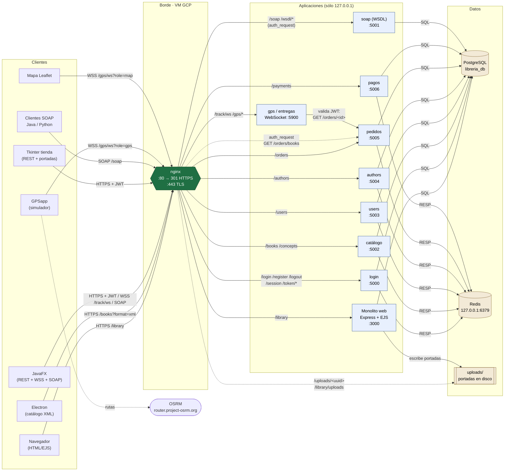
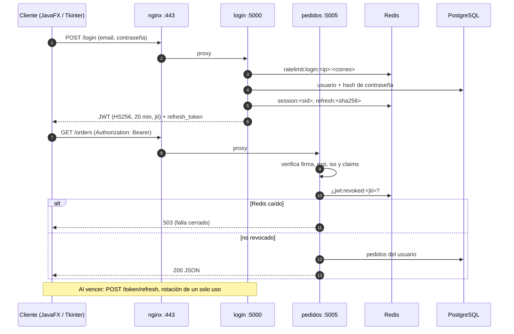
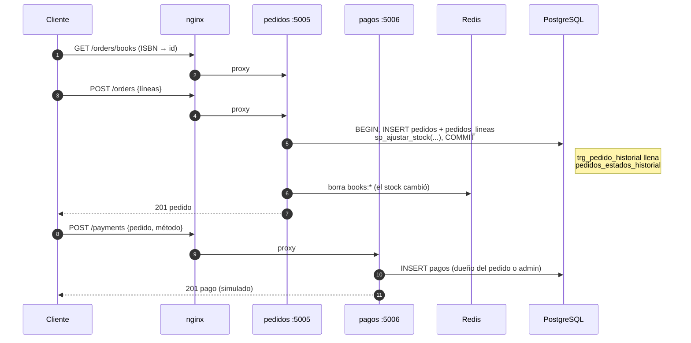
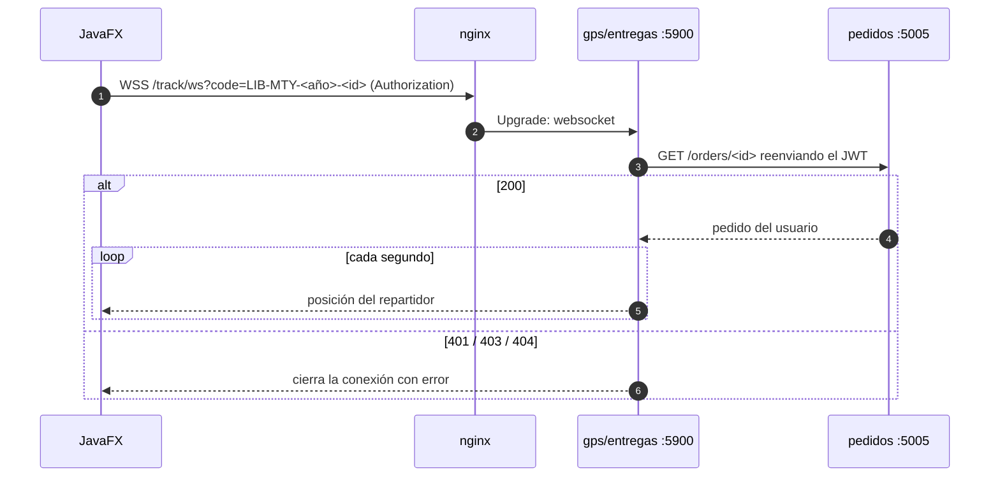
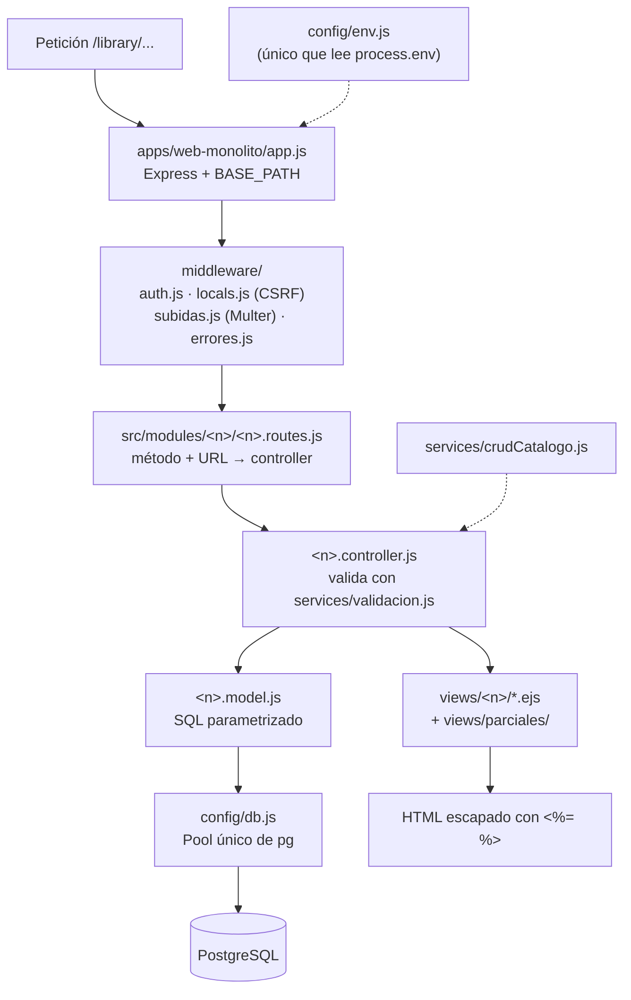
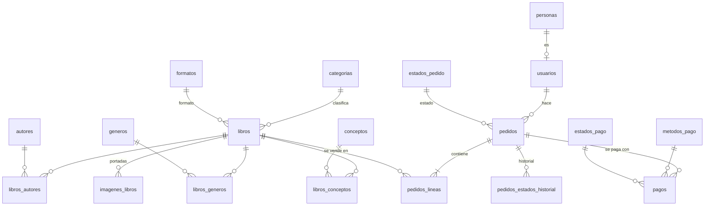
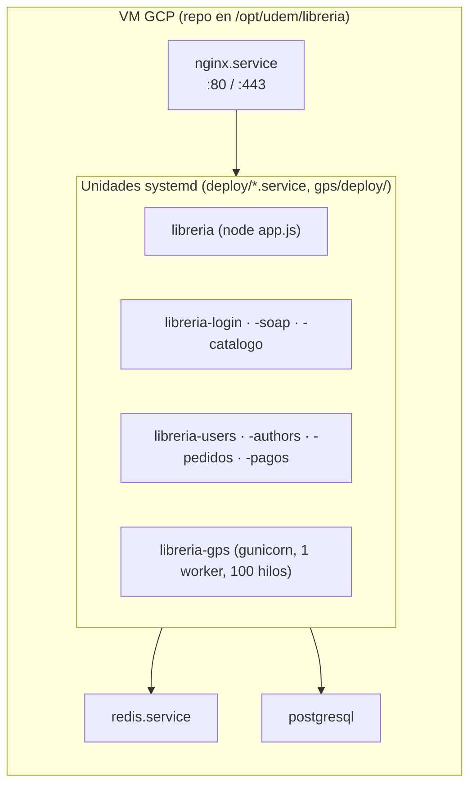
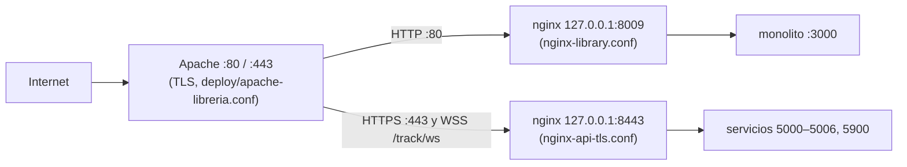

# Arquitectura de la Librería Online (con nginx como reverse proxy)

> **Escenario simulado.** Este documento supone que **nginx es el único reverse
> proxy en el borde**: termina TLS en 80/443 y reparte el tráfico a cada
> aplicación. En la VM real, Apache entra primero y nginx escucha detrás, en
> loopback (ver [Cómo es hoy en la VM](#cómo-es-hoy-en-la-vm)). Las rutas y los
> puertos internos salen de `deploy/nginx-api-tls.conf` y
> `deploy/nginx-library.conf`, que son los archivos reales.
>
> Las rutas de código del monolito se escriben completas
> (`apps/web-monolito/...`), porque este documento vive en `docs/`.

---

## 1. Resumen

La Librería Online es un **monorepo** con tres partes:

- un monolito web Node.js + Express + EJS;
- ocho servicios Python: siete microservicios Flask y el servicio de rastreo GPS;
- cuatro clientes de escritorio.

Las aplicaciones no comparten código. Sólo comparten la base PostgreSQL y, en el
caso de los servicios Python, una capa Redis auxiliar. Desde fuera, todo entra
por un único nginx, que publica dos superficies:

- **`/library/…`**: el sitio web (monolito, HTML renderizado en el servidor).
- **API (`/login`, `/books`, `/orders`, …)**: la consumen los clientes de
  escritorio, con JWT.

| Componente | Carpeta | Tecnología | Puerto interno | Unidad systemd |
|---|---|---|---|---|
| Monolito web | `apps/web-monolito/` | Node + Express + EJS + `pg` | 3000 | `libreria.service` |
| Login / sesiones / JWT | `apps/services/login/` | Flask + psycopg3 + Redis | 5000 | `libreria-login.service` |
| Clasificador SOAP (WSDL) | `apps/services/soap/` | Python SOAP | 5001 | `libreria-soap.service` |
| Catálogo XML/JSON | `apps/services/catalogo/` | Flask | 5002 | `libreria-catalogo.service` |
| Users | `apps/services/users/` | Flask + JWT | 5003 | `libreria-users.service` |
| Authors | `apps/services/authors/` | Flask + JWT | 5004 | `libreria-authors.service` |
| Pedidos | `apps/services/pedidos/` | Flask + JWT | 5005 | `libreria-pedidos.service` |
| Pagos (simulados) | `apps/services/pagos/` | Flask + JWT | 5006 | `libreria-pagos.service` |
| GPS / entregas (WebSocket) | `gps/microservice/` | Flask + flask-sock | 5900 | `libreria-gps.service` |
| PostgreSQL | `db/` (scripts) | PostgreSQL, base `libreria_db` | 5432 | servicio del sistema |
| Redis | — | Redis (`bind 127.0.0.1`, `requirepass`) | 6379 | `redis.service` |
| **nginx** | `deploy/` | Reverse proxy, terminación TLS | **80 / 443** | `nginx.service` |

Clientes:

| Cliente | Carpeta | Qué consume |
|---|---|---|
| Navegador | — | `/library/…` (HTML del monolito) |
| Electron | `apps/electron-app/` | Catálogo en **XML** (`/books?format=xml`) |
| JavaFX | `apps/JavaDesktop_app/` | REST + JWT, compra, rastreo por **WSS**, SOAP |
| Tkinter (tienda) | `apps/services/soap/cliente/` | REST + JWT, portadas, semáforos `/health/*` |
| Clientes SOAP | `clients/clasificador_java`, `clients/clasificador_python` | `/soap` y el WSDL |
| GPSapp y mapa | `gps/GPSapp/`, `gps/Map/` | WebSocket del GPS (simulador y visor) |

---

## 2. Diagrama general



**Cómo leerlo:**

- Ningún puerto interno (3000, 5000–5006, 5900, 5432, 6379) se publica fuera de la
  VM. Sólo nginx escucha en una interfaz pública.
- Las líneas punteadas no son tráfico de usuario. Representan la verificación
  `auth_request`, los estáticos servidos desde disco y la llamada a OSRM.
- En la VM real, el simulador GPS y el mapa hablan directo con `:5900`. Aquí pasan
  por nginx bajo `/gps/…` para completar el escenario de un solo punto de entrada.

---

## 3. Enrutamiento de nginx

| `location` | Upstream | Notas |
|---|---|---|
| `/library/uploads/` | disco: `apps/web-monolito/uploads/` | `alias`. `nosniff`, `Content-Disposition: inline` y se niegan las extensiones ejecutables |
| `/library/css/`, `/library/js/` | disco: `apps/web-monolito/public/` | Caché de 7 días |
| `/library` | `127.0.0.1:3000` | Conserva el prefijo (`proxy_pass` sin barra final; la app usa `BASE_PATH`). Pasa `X-Forwarded-*` y no guarda en búfer las páginas con sesión |
| `~ ^/(login\|register\|logout\|session\|token)` | `127.0.0.1:5000` | Login, sesión, JWT y refresh |
| `~ ^/users` | `127.0.0.1:5003` | JWT |
| `~ ^/authors` | `127.0.0.1:5004` | GET público, escritura sólo admin |
| `~ ^/orders` | `127.0.0.1:5005` | JWT |
| `~ ^/payments` | `127.0.0.1:5006` | JWT |
| `~ ^/(books\|concepts)` | `127.0.0.1:5002` | XML o JSON. Caché Redis de 60 s |
| `= /track/ws` | `127.0.0.1:5900` | **WebSocket** (`Upgrade`/`Connection`, timeout de 1 h) |
| `/gps/` *(simulado)* | `127.0.0.1:5900/` | Mapa y `/ws?role=gps\|map` por WebSocket |
| `= /soap`, `= /wsdl/library-classifier.wsdl` | `127.0.0.1:5001` | `auth_request /_jwt_valido` |
| `= /_jwt_valido` (`internal`) | `127.0.0.1:5005/orders/books` | nginx no verifica JWT: le pregunta a pedidos. 2xx deja pasar y 401 se devuelve tal cual |
| `~* ^/uploads/<uuid>.(png\|jpg\|webp)` | disco: `apps/web-monolito/uploads/` | Portadas para los clientes de escritorio |
| `= /health/<servicio>` | `:<puerto>/health` | Semáforos de los clientes |
| `= /metrics/<servicio>` | `:<puerto>/metrics` | Contadores en Redis (JWT de admin) |
| `/` | — | `return 404`: nada más se publica |

### Bloque de referencia (simulado, no está en `deploy/`)

Esta es la condensación de los dos `.conf` reales en un único servidor de borde:

```nginx
# Redirección: todo HTTP pasa a HTTPS
server {
    listen 80 default_server;
    return 301 https://$host$request_uri;
}

server {
    listen 443 ssl http2 default_server;
    ssl_certificate     /etc/pki/tls/certs/libreria-api.crt;
    ssl_certificate_key /etc/pki/tls/private/libreria-api.key;
    ssl_protocols       TLSv1.2 TLSv1.3;

    client_max_body_size 5m;
    proxy_set_header Host              $host;
    proxy_set_header X-Real-IP         $remote_addr;
    proxy_set_header X-Forwarded-For   $proxy_add_x_forwarded_for;
    proxy_set_header X-Forwarded-Proto $scheme;

    # --- Sitio web (monolito) ---
    location /library/uploads/ { alias /opt/udem/libreria/apps/web-monolito/uploads/; }
    location /library/css/     { alias /opt/udem/libreria/apps/web-monolito/public/css/; }
    location /library/js/      { alias /opt/udem/libreria/apps/web-monolito/public/js/; }
    location /library          { proxy_pass http://127.0.0.1:3000; proxy_buffering off; }

    # --- API ---
    location ~ ^/(login|register|logout|session|token)(/|$) { proxy_pass http://127.0.0.1:5000; }
    location ~ ^/users(/|$)    { proxy_pass http://127.0.0.1:5003; }
    location ~ ^/authors(/|$)  { proxy_pass http://127.0.0.1:5004; }
    location ~ ^/orders(/|$)   { proxy_pass http://127.0.0.1:5005; }
    location ~ ^/payments(/|$) { proxy_pass http://127.0.0.1:5006; }
    location ~ ^/(books|concepts)(/|$) { proxy_pass http://127.0.0.1:5002; }

    # --- WebSockets ---
    location = /track/ws {
        proxy_pass http://127.0.0.1:5900;
        proxy_http_version 1.1;
        proxy_set_header Upgrade    $http_upgrade;
        proxy_set_header Connection "upgrade";
        proxy_read_timeout 1h;
    }
    location /gps/ {
        proxy_pass http://127.0.0.1:5900/;
        proxy_http_version 1.1;
        proxy_set_header Upgrade    $http_upgrade;
        proxy_set_header Connection "upgrade";
    }

    # --- SOAP protegido con JWT ---
    location = /soap                          { auth_request /_jwt_valido; proxy_pass http://127.0.0.1:5001; }
    location = /wsdl/library-classifier.wsdl  { auth_request /_jwt_valido; proxy_pass http://127.0.0.1:5001; }
    location = /_jwt_valido {
        internal;
        proxy_pass http://127.0.0.1:5005/orders/books;
        proxy_pass_request_body off;
        proxy_set_header Content-Length "";
        proxy_set_header Authorization $http_authorization;
    }

    # --- Portadas para escritorio ---
    location ~* "^/uploads/([0-9a-f-]{36}\.(png|jpe?g|webp))$" {
        alias /opt/udem/libreria/apps/web-monolito/uploads/$1;
    }

    # --- Salud y métricas (un location por servicio) ---
    location = /health/login   { proxy_pass http://127.0.0.1:5000/health; }
    location = /metrics/login  { proxy_pass http://127.0.0.1:5000/metrics; }
    # … igual para catalogo, users, authors, pedidos y pagos

    location / { return 404; }
}
```

---

## 4. Flujos principales

### 4.1 Login, JWT y una petición autenticada



### 4.2 Compra (pedido + pago simulado)



### 4.3 Rastreo del pedido por WebSocket



---

## 5. El monolito por dentro (MVC por módulos)



Módulos de dominio (`apps/web-monolito/src/modules/`): `auth`, `autores`,
`categorias`, `conceptos`, `formatos`, `generos`, `imagenes`, `libros`, `panel`,
`usuarios`. Los catálogos simples (`nombre` + `descripcion`) reutilizan
`services/crudCatalogo.js` y `views/catalogo/`.

---

## 6. Seguridad por capas

| Capa | Mecanismo |
|---|---|
| Borde (nginx) | TLS 1.2/1.3 con certificado autofirmado (no hay dominio, sólo la IP). Redirección 80 → 443. Todo lo no listado devuelve 404 |
| Red | Apps, PostgreSQL y Redis sólo en `127.0.0.1`. Firewall con 80 y 443 abiertos |
| Identidad (API) | JWT HS256 de **20 min** emitido por login. Claims `sub`, `user_id`, `role_id`, `rol`, `email`, `iss`, `jti`. Algoritmo fijo |
| Revocación | `jwt:revoked:<jti>` en Redis. Refresh opaco de un solo uso, guardado como `sha256` |
| Autorización | 401 sin token y 403 con rol insuficiente. Cada servicio verifica por su cuenta |
| SOAP | `auth_request` de nginx delegado a pedidos |
| Rastreo | entregas reenvía el JWT a `GET /orders/<id>` |
| Monolito | Sesión con cookie, CSRF en todo formulario, validación server-side, escapado EJS y queries parametrizadas |
| Abuso | Limitador de login: 5 intentos en 15 min → 429 |
| CORS | `CORS_ORIGENES` explícito, nunca `*` |
| Secretos | Sólo en el `.env` de cada servicio en la VM (600, no versionado) |

---

## 7. Redis (capa auxiliar de los servicios Python)

| Clave | Escribe | TTL |
|---|---|---|
| `session:<sid>` | login | 8 h |
| `refresh:<sha256>` | login | igual que la sesión |
| `jwt:revoked:<jti>` | login (`/logout`, `/token/refresh`) | lo que le quede al JWT (≤ 20 min) |
| `ratelimit:login:<ip>:<correo>` | login | 15 min |
| `books:list:<filtros>`, `books:<isbn>` | catálogo (los borran authors y pedidos) | 60 s |
| `metrics:<servicio>:<contador>` | los seis | sin TTL |

**Política ante una caída de Redis:**

- Sesión, refresh, logout y toda ruta con JWT **fallan cerrado** y responden 503.
- `GET /books` y `GET /books/<isbn>` **fallan abierto** y leen de PostgreSQL.
- `/health` sigue en 200, pero con `redis: caido`, y el semáforo de los clientes
  se pone en amarillo.

---

## 8. Base de datos (resumen)

El esquema completo está en `db/01_schema.sql`. El diagrama detallado está en
[MANUAL_TECNICO.md](../MANUAL_TECNICO.md), sección "Base de datos". El modelo
está normalizado hasta 4FN. El total del pedido no se guarda: se calcula en
`v_pedidos_total`.



Los scripts `db/00…06_*.sql` reconstruyen la base y se ejecutan en orden. Los
cambios nuevos van en `db/pending/`, y en `db/applied/` sólo entran los que ya
corrieron en la VM.

---

## 9. Despliegue



- Cada servicio tiene su propio `.venv`, `requirements.txt`, `.env` y unidad. La
  Node app usa `npm ci --omit=dev` dentro de `apps/web-monolito/`.
- Para actualizar: `git pull`, luego `sudo systemctl restart libreria-<n>` en
  cada servicio que haya cambiado.

### Cómo es hoy en la VM

En la VM real, el borde no es nginx sino **Apache (`httpd`)**. Tiene el 80 y el
443 porque comparte la máquina con otro proyecto (Waylo). Apache termina TLS en
la IP y reenvía a nginx, que sólo escucha en loopback:



Pasar al escenario de este documento consistiría en dos cambios:

1. Unir los dos `server` de nginx en uno que escuche en 80 y 443.
2. Quitar `01-libreria.conf` de Apache. Eso sólo es posible si Waylo deja de
   necesitar esos puertos, o si se le da su propio `server_name` en nginx.
