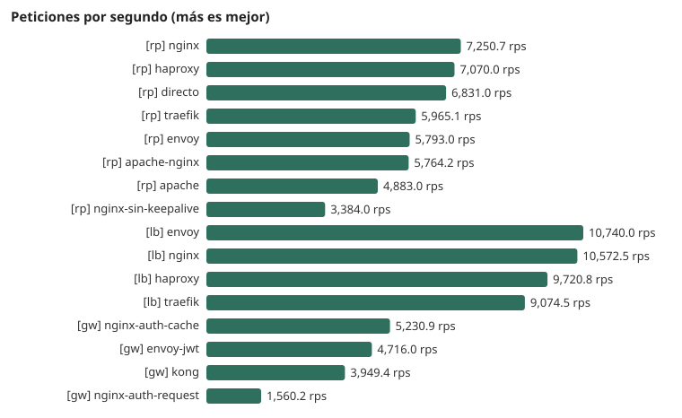
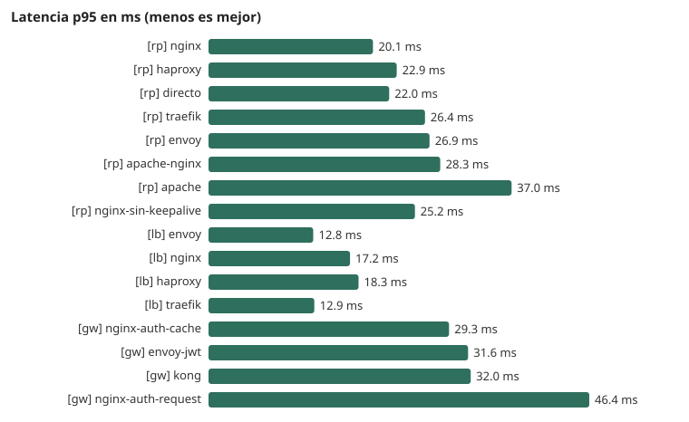

# Resultados del benchmark

Generado por `analizar.py`. Mediana de las repeticiones; latencias en ms; CPU y memoria muestreadas a media corrida con `docker stats` (100 % = un núcleo).

## Proxy inverso (1 backend)

| Herramienta | RPS | p50 | p95 | p99 | Errores | RPS vs. directo | +p50 vs. directo | CPU · memoria |
|---|---:|---:|---:|---:|---:|---:|---:|---|
| nginx | 7,251 | 5.24 | 20.05 | 44.61 | 0 | 106 % | -0.04 | nginx 27.14% · 6.641MiB |
| haproxy | 7,070 | 5.41 | 22.94 | 45.36 | 0 | 103 % | +0.12 | haproxy 29.51% · 11.93MiB |
| directo | 6,831 | 5.28 | 22.03 | 54.69 | 0 | 100 % | +0.00 | b1 101.03% · 10.84MiB |
| traefik | 5,965 | 6.04 | 26.39 | 58.45 | 0 | 87 % | +0.76 | traefik 51.55% · 87.72MiB |
| envoy | 5,793 | 6.36 | 26.94 | 56.09 | 0 | 85 % | +1.08 | envoy 52.33% · 24.46MiB |
| apache-nginx | 5,764 | 6.17 | 28.25 | 64.50 | 0 | 84 % | +0.89 | apache 36.77% · 20.2MiB<br>nginx 20.80% · 6.141MiB |
| apache | 4,883 | 6.30 | 36.95 | 95.70 | 0 | 71 % | +1.02 | apache 40.21% · 15.54MiB |
| nginx-sin-keepalive | 3,384 | 13.52 | 25.16 | 36.38 | 0 | 50 % | +8.24 | nginx 42.89% · 10.13MiB |

## Balanceador (3 backends)

| Herramienta | RPS | p50 | p95 | p99 | Errores | Reparto b1 / b2 / b3 | CPU · memoria |
|---|---:|---:|---:|---:|---:|---|---|
| envoy | 10,740 | 2.31 | 12.77 | 32.30 | 0 | 33.3 % / 33.3 % / 33.3 % | envoy 66.20% · 26.89MiB |
| nginx | 10,573 | 1.07 | 17.25 | 40.53 | 0 | 33.3 % / 33.3 % / 33.3 % | nginx 55.05% · 7.738MiB |
| haproxy | 9,721 | 1.42 | 18.30 | 38.41 | 0 | 33.3 % / 33.3 % / 33.3 % | haproxy 53.20% · 12.95MiB |
| traefik | 9,074 | 4.33 | 12.90 | 23.18 | 0 | 33.3 % / 33.3 % / 33.3 % | traefik 97.83% · 135.6MiB |

## API gateway (JWT + límite)

| Herramienta | RPS | p50 | p95 | p99 | Errores | CPU · memoria |
|---|---:|---:|---:|---:|---:|---|
| nginx-auth-cache | 5,231 | 7.04 | 29.32 | 57.06 | 0 | nginx 31.52% · 7.68MiB<br>auth 0.09% · 56.04MiB |
| envoy-jwt | 4,716 | 7.61 | 31.64 | 59.20 | 0 | envoy 58.93% · 26.79MiB |
| kong | 3,949 | 9.40 | 31.96 | 53.36 | 0 | kong 98.27% · 191.6MiB |
| nginx-auth-request | 1,560 | 29.96 | 46.42 | 74.34 | 0 | nginx 54.41% · 12.43MiB<br>auth 101.03% · 57.7MiB |

## Conmutación por error (b3 cae a los 10 s y vuelve a los 20 s, 30 s de carga)

| Balanceador | Peticiones | Fallidas | % fallidas | p99 | Reparto b1 / b2 / b3 |
|---|---:|---:|---:|---:|---|
| envoy | 311,789 | 1,235 | 0.396 % | 32.4 | 38.2 % / 38.2 % / 23.5 % |
| haproxy | 277,086 | 0 | 0.000 % | 32.3 | 37.6 % / 37.6 % / 24.7 % |
| nginx | 288,314 | 0 | 0.000 % | 41.8 | 39.2 % / 39.2 % / 21.6 % |
| traefik | 252,394 | 54 | 0.021 % | 20.2 | 39.1 % / 39.1 % / 21.8 % |

## Memoria en reposo

| Contenedor | Memoria |
|---|---:|
| nginx | 5.457MiB |
| haproxy | 10.42MiB |
| traefik | 26.73MiB |
| envoy | 21.71MiB |
| apache | 6.039MiB |
| kong | 118.1MiB |
| auth | 50.82MiB |

## Pruebas funcionales de seguridad de los gateways

```
== nginx + auth_request (http://172.28.0.20:82)
  OK    sin token                esperado 401  obtenido 401
  OK    token válido             esperado 200  obtenido 200
  OK    token expirado           esperado 401  obtenido 401
  OK    firma con otro secreto   esperado 401  obtenido 401
  OK    alg=none                 esperado 401  obtenido 401
  OK    ráfaga de 50 a /limitado (10 r/s)   200=11  429=39
== Kong (http://172.28.0.25:8000)
  OK    sin token                esperado 401  obtenido 401
  OK    token válido             esperado 200  obtenido 200
  OK    token expirado           esperado 401  obtenido 401
  OK    firma con otro secreto   esperado 401  obtenido 401
  OK    alg=none                 esperado 401  obtenido 401
  OK    ráfaga de 50 a /limitado (10 r/s)   200=11  429=39
== Envoy (jwt_authn) (http://172.28.0.23:8082)
  OK    sin token                esperado 401  obtenido 401
  OK    token válido             esperado 200  obtenido 200
  OK    token expirado           esperado 401  obtenido 401
  OK    firma con otro secreto   esperado 401  obtenido 401
  OK    alg=none                 esperado 401  obtenido 401
  OK    ráfaga de 50 a /limitado (10 r/s)   200=10  429=40

Total de fallos: 0
```

## Gráficas




