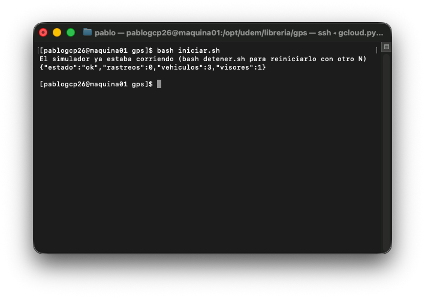
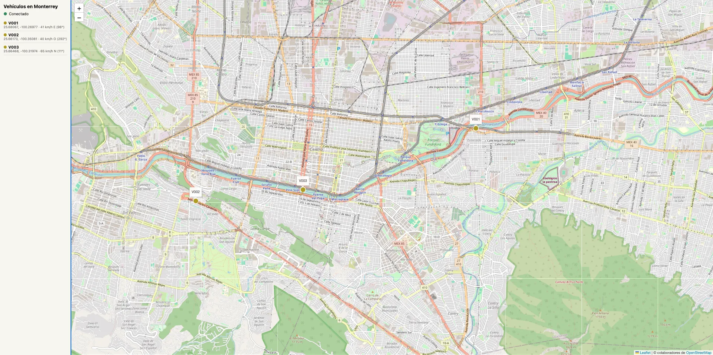
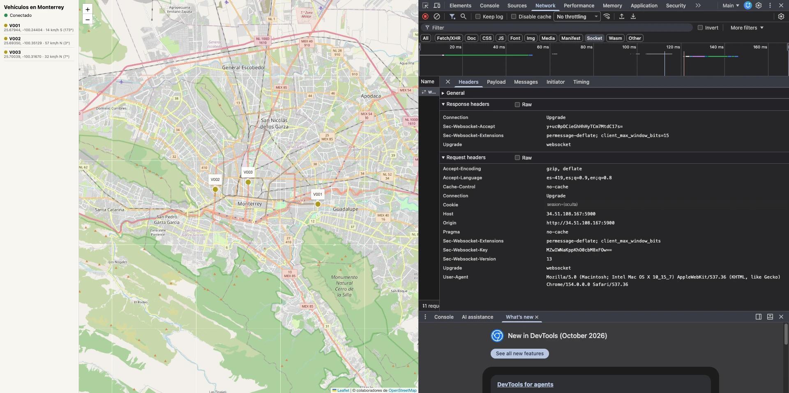
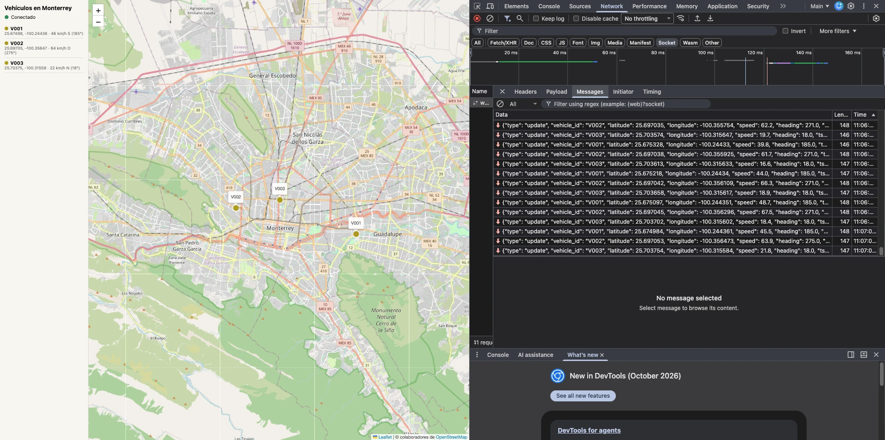
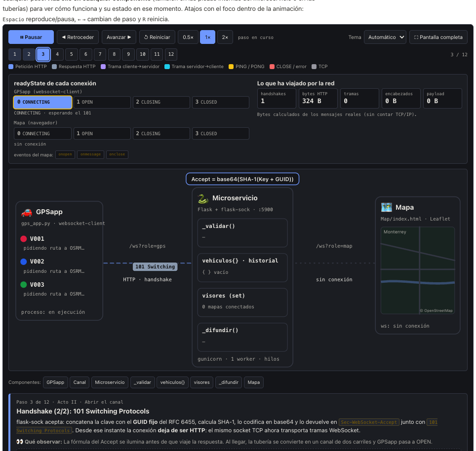
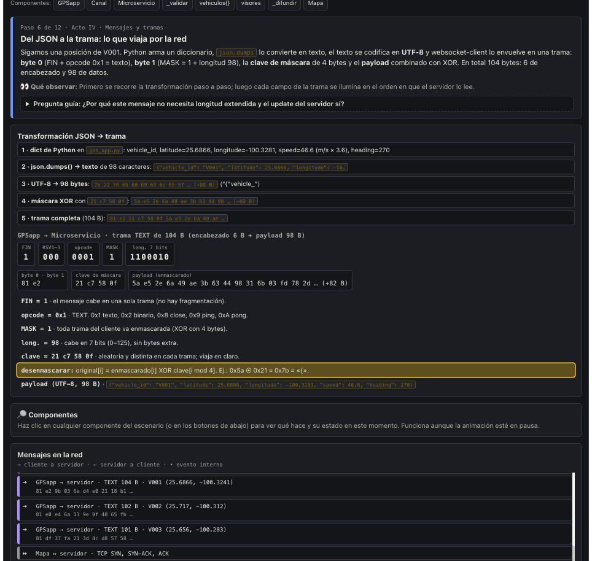
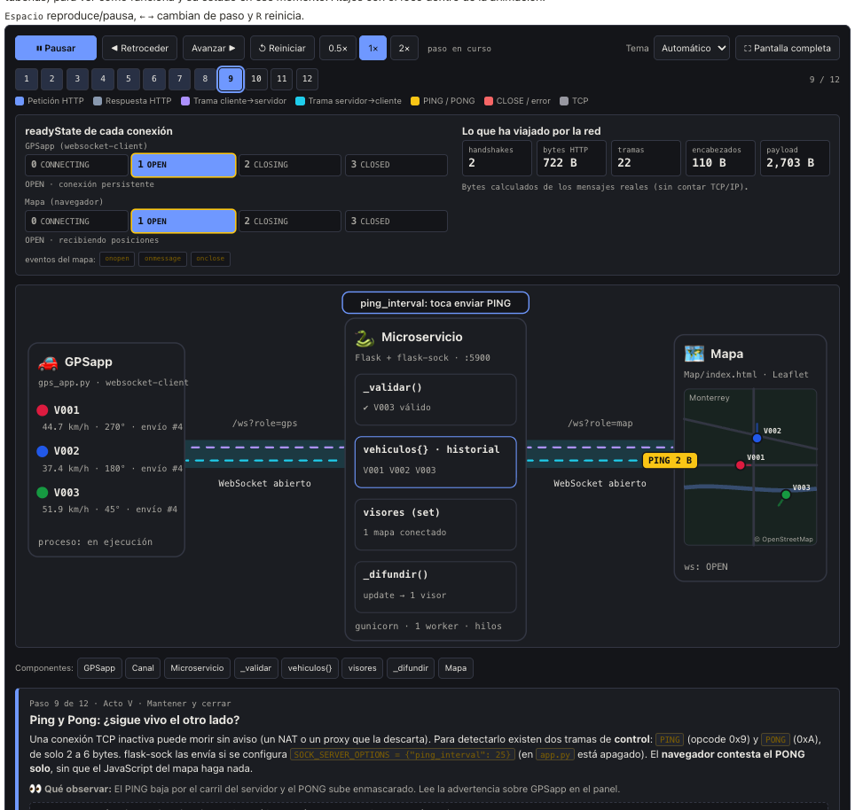
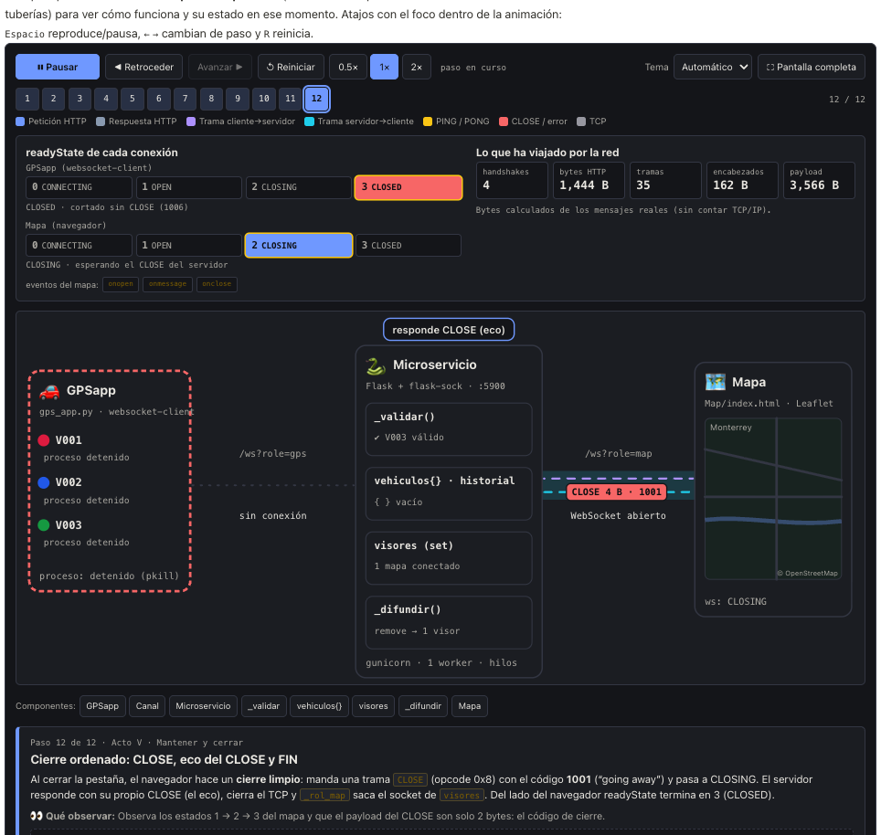

# Vehículos en tiempo real por Monterrey con WebSockets

**Integración de Aplicaciones · Módulo III** · Noviembre de 2026\
Código: `gps/` · Animación: `ubiquitous/ejercicio07/`

> Las rutas de este documento son relativas a la raíz del monorepo, salvo la
> animación, que vive en la carpeta del portafolio de Ubiquitous.

---

## A. Reporte técnico

### A.1 Objetivo

Construir una aplicación distribuida que simule vehículos recorriendo las calles de
Monterrey y muestre sus ubicaciones en un mapa en tiempo real. Las posiciones viajan
por **WebSockets**: un simulador las produce, un microservicio las recibe y las
difunde, y una página web las dibuja sin recargarse. Una animación interactiva,
publicada en Ubiquitous, explica qué pasa dentro de esas conexiones.

### A.2 Arquitectura de componentes

```diagrama
 ┌─── Simulador (VM o Mac) ───┐              ┌───────────── VM de GCP (CentOS) ─────────────┐
 │ GPSapp/gps_app.py          │   ws://      │ microservice/app.py                    :5900 │
 │  V001 · V002 · V003        │ /ws?role=gps │  Flask + flask-sock (gunicorn, 1 worker)     │
 │  rutas por calles (OSRM)   ├─── JSON ────►│  _rol_gps: valida, guarda el último punto    │
 │  1 JSON por vehículo / 1 s │              │            y 200 de historial                │
 │  reintenta cada 3 s        │◄── error ────┤  _rol_map: snapshot y luego update / remove  │
 └────────────────────────────┘              │  GET /  sirve el mapa · GET /health          │
                                             └──────────────────────┬───────────────────────┘
                                                                    │ ws://  /ws?role=map
                                                                    │ snapshot · update · remove
                                                                    ▼
                                             ┌───────────────── Navegador ──────────────────┐
                                             │ Map/index.html: Leaflet + OpenStreetMap      │
                                             │  un marcador y una estela por vehículo       │
                                             │  reconecta a los 2 s                         │
                                             └──────────────────────────────────────────────┘
```

Hay **dos conexiones WebSocket distintas** con papeles opuestos. El simulador sólo
produce: abre `/ws?role=gps` y empuja posiciones. El mapa sólo consume: abre
`/ws?role=map` y recibe lo que el servidor le empuja. El microservicio es el único
que conoce a los dos; guarda el estado en memoria y hace el *broadcast*. Ningún
componente toca la base de datos.

### A.3 Tecnologías

| Componente | Tecnología |
|---|---|
| Microservicio | Python 3, Flask 3.0, flask-sock 0.7, gunicorn 22 (1 worker, 100 hilos) |
| Simulador | Python 3, `websocket-client` 1.8, rutas de OSRM sobre OpenStreetMap |
| Mapa | HTML5, CSS3, JavaScript, `WebSocket` del navegador, Leaflet 1.9.4, tiles de OpenStreetMap |
| Animación | HTML, CSS, JavaScript y SVG, sin bibliotecas, videos ni imágenes |
| Infraestructura | VM de Google Compute Engine, systemd (`libreria-gps`), firewalld y regla de GCP para el 5900 |

### A.4 Componentes

**Microservicio** (`gps/microservice/app.py`). Un solo endpoint `/ws` que decide qué
hacer según `?role=`:

- `role=gps`: lee cada mensaje, lo valida y, si es correcto, guarda el último
  registro del vehículo y lo agrega a su historial (200 puntos). Después lo reenvía
  a todos los mapas como `update`. Si el mensaje no es válido, contesta un `error`
  sólo a ese simulador y sigue escuchando.
- `role=map`: registra la conexión como visor, le manda un `snapshot` con todos los
  vehículos y su historial, y se queda esperando sólo para detectar el cierre.
- Un `role` distinto recibe un `error` y se cierra.

La validación rechaza lo que no sea JSON, lo que no traiga `vehicle_id` (texto de 1 a
40 caracteres) y las coordenadas fuera de Monterrey (latitud 25.50 a 25.85, longitud
−100.50 a −100.15). `speed` debe estar entre 0 y 200 km/h y `heading` entre 0 y 360°.

Corre con **un solo worker** porque las posiciones viven en la memoria del proceso;
los hilos de gunicorn atienden las conexiones abiertas. También sirve la página del
mapa en `/` y el estado en `/health` (número de vehículos y de visores).

**Simulador** (`gps/GPSapp/gps_app.py`). Una aplicación independiente que simula **tres
vehículos** por omisión (V001, V002 y V003); con `--vehiculos N` simula N y con
`--id` sólo uno. Cada vehículo pide a OSRM una ruta por calles reales hacia un
destino al azar dentro de la zona urbana, avanza por ella a una velocidad de 15 a
80 km/h que cambia poco en cada paso, y al llegar pide otra ruta desde ahí. Cada
segundo manda la posición de cada vehículo por **una sola conexión** WebSocket. Si
la conexión se cae, reintenta cada 3 segundos.

**Mapa** (`gps/Map/index.html`). Abre un WebSocket como visor. Con el `snapshot`
dibuja cada vehículo con un color propio, su etiqueta y su estela; con cada
`update` mueve el marcador interpolando durante un segundo, para que el movimiento
se vea continuo; con `remove` lo quita. La lista lateral muestra coordenadas,
velocidad y rumbo, y al hacer clic centra el mapa en el vehículo. Si la conexión se
cierra, el indicador pasa a rojo y la página reconecta a los 2 segundos. Las
etiquetas se insertan como texto, nunca como HTML, porque el `vehicle_id` lo manda
cualquier cliente.

**Animación** (`ubiquitous/ejercicio07/`). Un recorrido de 12 pasos por las dos
conexiones de esta aplicación. Se puede iniciar, pausar, avanzar, retroceder,
reiniciar, saltar a cualquier paso y cambiar la velocidad; al hacer clic en
cualquiera de los 8 componentes muestra cómo funciona y su estado en ese momento.
Los bytes de cada trama y el `Sec-WebSocket-Accept` se calculan en el navegador.

### A.5 Mensajes intercambiados

**Establecimiento (HTTP Upgrade).** Cada conexión empieza como una petición HTTP
normal que pide cambiar de protocolo:

```
GET /ws?role=gps HTTP/1.1
Host: 34.51.108.167:5900
Upgrade: websocket
Connection: Upgrade
Sec-WebSocket-Key: dGhlIHNhbXBsZSBub25jZQ==
Sec-WebSocket-Version: 13

HTTP/1.1 101 Switching Protocols
Upgrade: websocket
Connection: Upgrade
Sec-WebSocket-Accept: s3pPLMBiTxaQ9kYGzzhZRbK+xOo=
```

`Sec-WebSocket-Key` es un valor aleatorio del cliente. El servidor le concatena un
GUID fijo, calcula SHA-1 y lo codifica en base64; así el cliente comprueba que del
otro lado hay un servidor WebSocket de verdad y no una caché. Después del `101`, la
misma conexión TCP deja de hablar HTTP y empieza a transportar **tramas**.

**Mensajes de la aplicación.** Todos son JSON dentro de tramas de texto (opcode `0x1`):

| Sentido | Mensaje | Cuándo |
|---|---|---|
| simulador → servidor | `{"vehicle_id": "V001", "latitude": 25.6746, "longitude": -100.3281, "speed": 46.6, "heading": 270}` | Cada segundo, por vehículo |
| servidor → simulador | `{"type": "error", "message": "coordenadas fuera de Monterrey"}` | Mensaje inválido |
| servidor → mapa | `{"type": "snapshot", "vehicles": [{…, "history": [[lat, lon], …]}]}` | Al conectarse el mapa |
| servidor → mapa | `{"type": "update", "vehicle_id": "V001", …, "ts": 1793894403.25}` | Cada posición válida |
| servidor → mapa | `{"type": "remove", "vehicle_id": "V001"}` | Al desconectarse el simulador |

**Mensajes de control.** `PING` (`0x9`) y `PONG` (`0xA`) comprueban que la conexión
sigue viva; `CLOSE` (`0x8`) lleva un código (por ejemplo 1001 al cerrar la pestaña) y
se contesta con otro `CLOSE` antes de cerrar el TCP.

**Anatomía de una trama.**

| Parte | Tamaño | Contenido |
|---|---|---|
| Byte 0 | 1 B | `FIN` (último fragmento), `RSV1-3` y el opcode. Un texto completo empieza con `0x81` |
| Byte 1 | 1 B | `MASK` y la longitud. Hasta 125 va directa; 126 indica que la longitud real va en los 2 bytes siguientes; 127, en 8 |
| Clave de máscara | 4 B | Sólo en tramas del cliente. Las del servidor no la llevan |
| Payload | variable | El JSON en UTF-8; si hay máscara, cada byte va con XOR contra `clave[i mod 4]` |

Una posición del simulador (~98 B de JSON) viaja con 6 B de encabezado (2 B más los 4
de la máscara). Un `update` hacia el mapa pasa de 125 B, así que usa longitud
extendida: 4 B de encabezado y ningún byte de máscara.

### A.6 Ciclo de vida de la conexión

1. **Creación.** El cliente abre TCP con el servidor y manda el `GET` con `Upgrade`. Al
   recibir `101`, la conexión queda abierta y cada lado puede enviar cuando quiera.
2. **Mantenimiento.** No se vuelve a mandar ningún encabezado HTTP: cada posición
   cuesta sólo los bytes de su trama. flask-sock sólo manda `PING` si se configura
   `ping_interval`, y en `app.py` está apagado; si llega uno, el navegador contesta el
   `PONG` solo. En el servidor cada conexión ocupa un hilo de
   gunicorn mientras está abierta.
3. **Bidireccionalidad.** Por la conexión del simulador viajan posiciones hacia el
   servidor y errores de regreso; por la del mapa, el `snapshot` y los `update`.
   Ninguna de las dos espera una petición para que el otro lado envíe.
4. **Cierre normal.** Al cerrar la pestaña, el navegador manda `CLOSE 1001`; el servidor
   lo contesta y lo saca de los visores.
5. **Desconexión.** Si el simulador se detiene o se corta la red, el servidor detecta
   el fin de la conexión, borra esos vehículos y manda `remove` a los mapas. El
   simulador reintenta cada 3 s y el mapa cada 2 s, y al volver reciben un estado
   nuevo.

### A.7 Despliegue en la VM

El microservicio corre como la unidad de systemd `libreria-gps` en el puerto 5900,
abierto en firewalld y en una regla de GCP. Desde `gps/` en la VM, `bash iniciar.sh`
arranca el servicio y el simulador con tres vehículos, y `bash detener.sh` apaga ambos.
El mapa se abre en `http://34.51.108.167:5900/`. Los pasos completos están en
`gps/README.md`.

### A.8 Evidencias del funcionamiento

Pruebas sin red:

- Simulador contra el microservicio en local, con un OSRM falso: un solo proceso
  registró `"vehiculos":3`; al detenerlo, los tres desaparecieron; con `--id V007`
  apareció uno solo y `--vehiculos 0` se rechazó.
- `python3 gps/microservice/pruebas.py`: **50 comprobaciones, 0 fallos** (rastreo de
  pedidos del mismo microservicio).

En la VM, `bash iniciar.sh` respondió `{"estado":"ok","vehiculos":3,"visores":0}`.

Capturas (archivos en `evidencias/gps/`):

<figure class="grande"><figcaption>Fig. 1. <code>bash iniciar.sh</code> en la VM: el simulador ya corría, y <code>/health</code> reporta tres vehículos y un mapa conectado.</figcaption></figure>
<figure class="grande"><figcaption>Fig. 2. El mapa en <code>http://34.51.108.167:5900/</code> con V001, V002 y V003; a la izquierda, su posición, velocidad y rumbo.</figcaption></figure>
<figure class="grande"><figcaption>Fig. 3. Handshake real del mapa en las herramientas de Chrome: la petición con <code>Upgrade</code>, <code>Sec-WebSocket-Key</code> y <code>Version: 13</code>, y la respuesta con <code>Sec-WebSocket-Accept</code>. La cookie de sesión está tapada.</figcaption></figure>
<figure class="grande"><figcaption>Fig. 4. Pestaña Mensajes de la misma conexión: un <code>update</code> por vehículo cada segundo, de 146 a 148 B cada uno (más de 125, por eso usan longitud extendida).</figcaption></figure>
<figure class="grande"><figcaption>Fig. 5. Animación: el handshake con <code>Upgrade</code> y la respuesta <code>101 Switching Protocols</code>.</figcaption></figure>
<figure class="grande"><figcaption>Fig. 6. Animación: una trama con su encabezado, la máscara y el payload.</figcaption></figure>
<figure class="grande"><figcaption>Fig. 7. Animación: el servidor manda un <code>PING</code> de 2 B al mapa y el navegador contesta el <code>PONG</code> solo.</figcaption></figure>
<figure class="grande"><figcaption>Fig. 8. Animación: el mapa cierra con <code>CLOSE 1001</code> y queda en CLOSING esperando el eco del servidor; GPSapp ya está en CLOSED porque se cortó sin <code>CLOSE</code> (1006).</figcaption></figure>

---

## B. Reflexión individual sobre el uso de inteligencia artificial

**1. ¿Qué herramientas de IA utilicé y cómo me ayudaron?** Usé Claude Code, con el
modelo Claude Opus 5.5, desde su aplicación de escritorio y trabajando sobre mi copia
local del repositorio. La IA no tenía acceso a la VM: yo ejecutaba los comandos en el
servidor y le compartía la salida. Me ayudó a:

- Generar la primera versión de los tres componentes a partir de mi enunciado.
- Revisar el código contra los requisitos de la actividad y señalar lo que faltaba.
- Escribir la animación, calcular las tramas byte a byte y el `Sec-WebSocket-Accept`.
- Preparar los comandos de despliegue paso a paso y dar formato a este documento.

**2. ¿Cómo se establece, mantiene y cierra una conexión WebSocket?** Se establece con
una petición HTTP `GET` que lleva `Upgrade: websocket`, `Connection: Upgrade`,
`Sec-WebSocket-Key` y `Sec-WebSocket-Version: 13`. Si el servidor acepta, responde
`101 Switching Protocols` con el `Sec-WebSocket-Accept` calculado a partir de la clave.
Desde ese momento la conexión TCP queda abierta y los dos lados se mandan tramas sin
volver a hablar HTTP. Se mantiene mientras ninguno la cierre; los `PING` y `PONG`
sirven para comprobar que el otro lado sigue respondiendo. Se cierra con una trama
`CLOSE` con un código, que el otro lado contesta con otro `CLOSE`. Si la red se corta
sin `CLOSE`, el servidor lo detecta al fallar la lectura; en mi aplicación eso
dispara el `remove` y los clientes reintentan solos.

**3. ¿Qué información viaja por la red y qué función cumplen los encabezados y las
tramas?** Al principio viaja el handshake HTTP con sus encabezados, que sirven para
negociar el cambio de protocolo y comprobar que los dos lados hablan WebSocket.
Después viajan tramas. Cada trama tiene un encabezado de 2 a 14 bytes que dice si es
el último fragmento (`FIN`), qué tipo de mensaje es (opcode: texto, `PING`, `PONG`,
`CLOSE`), cuánto mide el payload y si va enmascarado. El payload es el dato: en mi
aplicación, un JSON con `vehicle_id`, latitud, longitud, velocidad y rumbo. Los
mensajes del cliente van enmascarados con una clave de 4 bytes para que ningún proxy
intermedio los confunda con HTTP.

**4. ¿Qué diferencias identifiqué entre HTTP y WebSockets?**

- **Quién inicia:** en HTTP siempre pregunta el cliente; con WebSocket el servidor
  empuja los datos cuando ocurren.
- **Conexión:** cada petición HTTP es independiente; el WebSocket es una sola conexión
  persistente.
- **Costo por mensaje:** cada petición HTTP repite cientos de bytes de encabezados;
  una posición por WebSocket cuesta de 4 a 6 bytes de encabezado.
- **Estado:** HTTP es sin estado y fácil de escalar; el WebSocket guarda estado en el
  servidor, por eso mi microservicio necesita un solo worker.
- **Uso:** para el mapa, consultar por HTTP cada segundo daría un movimiento a saltos
  y muchas peticiones vacías; con WebSocket la posición llega en cuanto se genera.

**5. ¿Qué aprendí al desarrollar la animación y qué modificaciones realicé al código
generado por IA?** Al animar mi propia aplicación entendí que el WebSocket del GPS y el
del mapa son el mismo protocolo con papeles opuestos, y que el microservicio es el que
conecta los dos. También vi detalles que no había notado al programarla: los `update`
pasan de 125 bytes y necesitan longitud extendida, el servidor convierte `heading` a
número decimal, el simulador nunca lee lo que el servidor le contesta y, si el
servicio se reinicia, el mapa queda vacío hasta que el simulador reconecta, porque el
estado vive en memoria.

Sobre el código, la primera versión no me bastó y fui pidiendo cambios:

- Los vehículos se movían en línea recta atravesando manzanas; pedí que siguieran
  calles reales, y se cambió a rutas de OSRM.
- Alineé el protocolo con lo que pedía la actividad: un solo endpoint con
  `?role=gps|map` y mensajes con velocidad, rumbo, `snapshot` e historial.
- Al revisar los requisitos noté que cada proceso movía un solo vehículo y que los
  tres salían de un script; lo cambié para que la aplicación simule tres por sí misma.
- Se corrigió que el mapa insertaba el `vehicle_id` como HTML, lo que permitía meter
  código desde cualquier cliente.
- Agregué `iniciar.sh` y `detener.sh` para levantar y apagar todo con un comando.
- En la animación reutilicé el motor del ejercicio anterior y lo adapté a las dos
  conexiones de mi aplicación, con los mensajes reales de mi código.

**6. ¿Podría explicar el funcionamiento de mi aplicación sin utilizar IA?** Sí. Sé qué
hace cada componente y por qué: el simulador produce posiciones, el microservicio las
valida, las guarda en memoria y las reenvía, y el mapa sólo las dibuja. Puedo explicar
el handshake, qué lleva cada trama y qué pasa cuando una conexión se cae, porque lo
revisé paso a paso al hacer la animación y al probarla en la VM. La IA me ahorró
escribir mucho código, pero las decisiones (los roles, un solo worker, rutas por
calles, cómo desplegarlo) las entendí y las tomé yo.

---

## C. Entrega

- **URL pública de la animación:** <https://ubiquitous.udem.edu/~iac-611194/ejercicio07/>
- **Mapa en la VM:** `http://34.51.108.167:5900/`
- **Código fuente:**
  - Microservicio: `gps/microservice/`
  - Simulador: `gps/GPSapp/`
  - Mapa: `gps/Map/`
  - Animación: `ubiquitous/ejercicio07/`
- **Instrucciones de ejecución:** `gps/README.md`.
