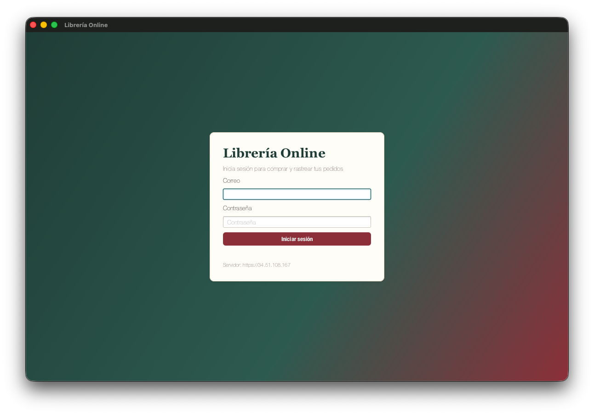
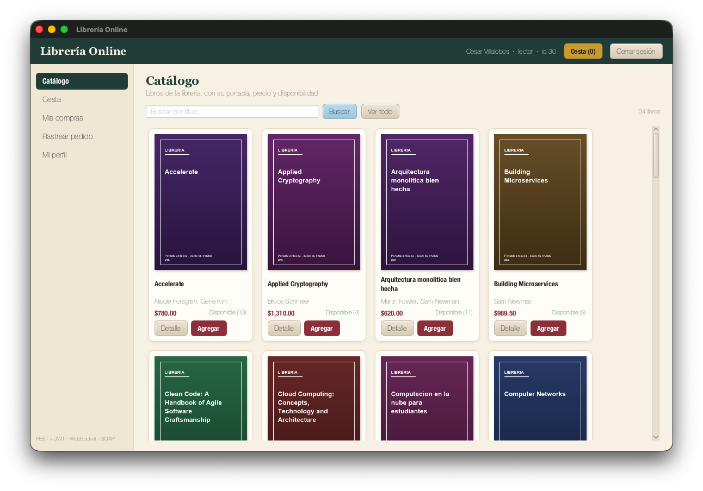
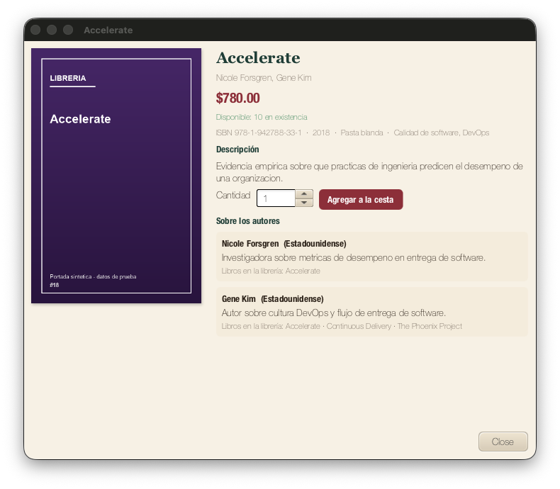
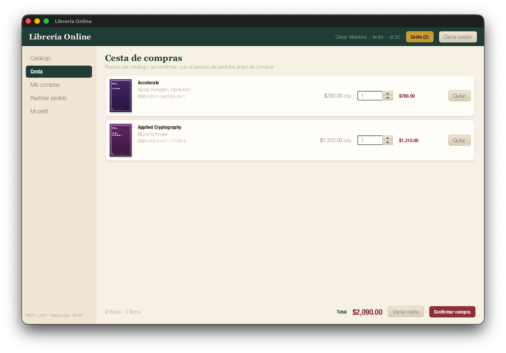
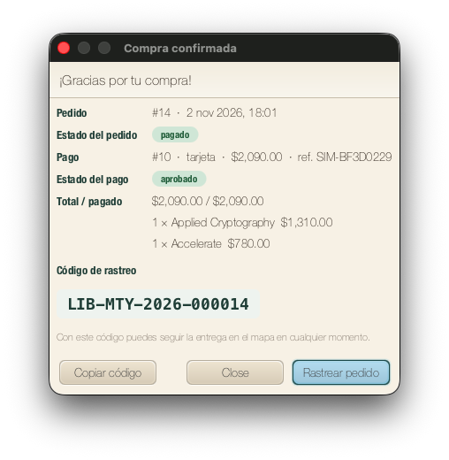
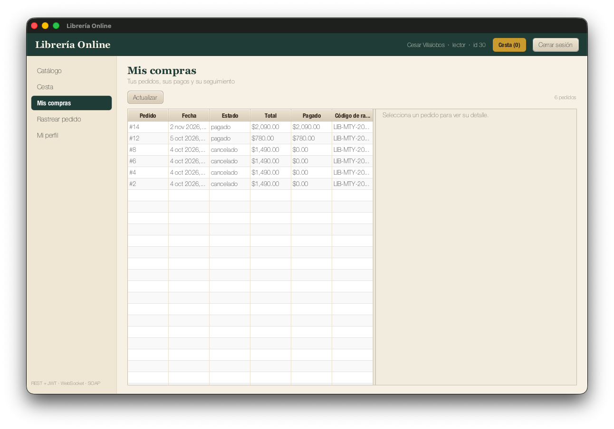
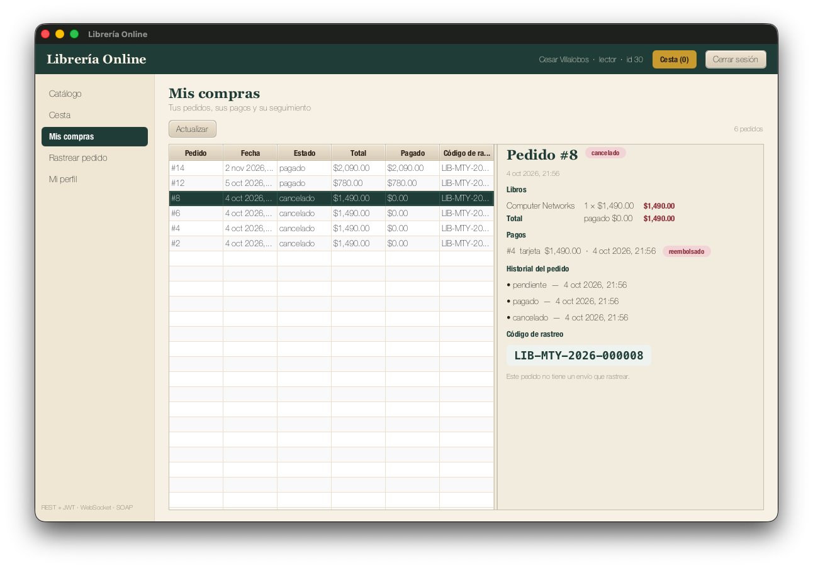
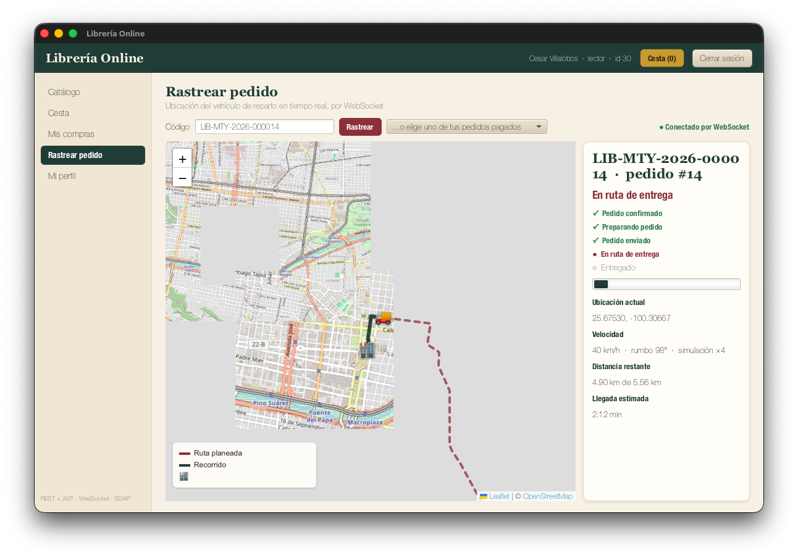
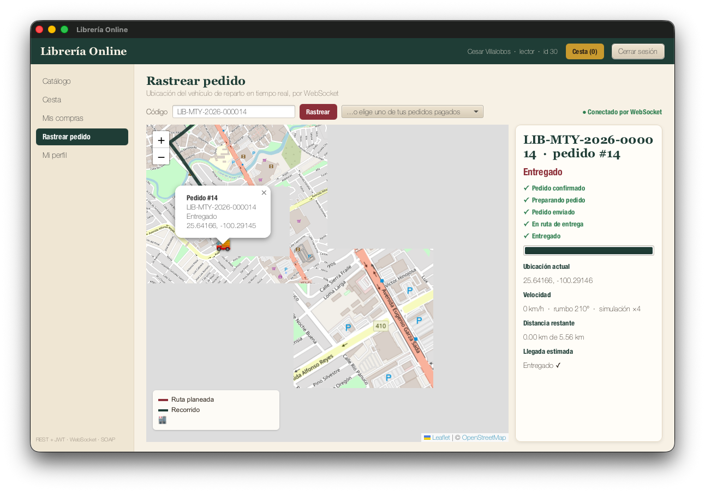
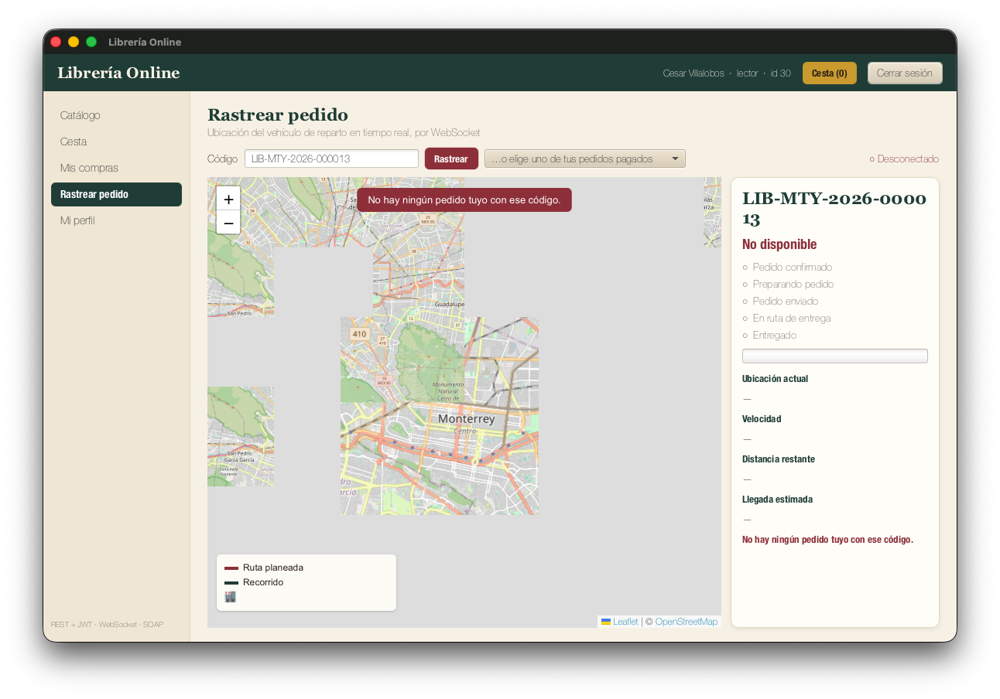

# Librería Online: cliente de escritorio en Java con rastreo GPS por WebSockets

**Integración de Aplicaciones · Monorepo Library** · Noviembre de 2026\
Código: `apps/JavaDesktop_app/` · Rastreo: `gps/microservice/entregas.py`

> Las rutas de este documento son relativas a la raíz del monorepo.

---

## A. Explicación de la aplicación

### A.1 Objetivo

Construir una aplicación de **escritorio** en Java (JavaFX) que funcione como
cliente del sistema distribuido Library: el usuario se autentica con JWT, consulta
el catálogo con portadas y descripciones, arma una cesta, simula la compra (pedido
y pago reales en los microservicios), revisa sus compras y sigue la entrega en un
mapa de Monterrey que se actualiza en tiempo real por WebSockets. La aplicación no
se conecta a PostgreSQL: todo pasa por los servicios desplegados en la VM de GCP.

### A.2 Arquitectura de componentes

```diagrama
 ┌──────────────── Mac del usuario ────────────────┐        ┌────────────── VM de GCP (CentOS) ──────────────┐
 │ App JavaFX                                      │ HTTPS  │ Apache :443 (TLS) ─► nginx 127.0.0.1:8443      │
 │  ApiClient ── REST/JSON + Bearer JWT ───────────┼───────►│  /login /token /logout ─► login     :5000      │
 │  LibreriaApi                                    │        │  /users ────────────────► users     :5003      │
 │  Cesta (memoria)                                │        │  /books ────────────────► catalogo  :5002 ─┐   │
 │  SoapService ── SOAP 1.1/XML + JWT ─────────────┼───────►│  /authors ──────────────► authors   :5004  │   │
 │  RastreoClient ── WebSocket (wss) + JWT ────────┼───────►│  /orders ───────────────► pedidos   :5005 ─┼─► PostgreSQL
 │      │                                          │        │  /payments ─────────────► pagos     :5006  │   │
 │      ▼ executeScript("actualizar(…)")           │        │  /soap (auth_request) ──► soap      :5001 ─┘   │
 │  WebView: Leaflet + OpenStreetMap               │        │  /track/ws ─────────────► gps       :5900      │
 └─────────────────────────────────────────────────┘        │     gps ── GET /orders/{id} + JWT ─► pedidos   │
                                                            │  Redis: sesiones, revocación de JWT, caché     │
                                                            └────────────────────────────────────────────────┘
```

Los dos caminos que pide la actividad están separados:

- **Aplicación Java → microservicios REST → pedidos y pagos** (síncrono, petición/respuesta).
- **Simulador GPS → servidor WebSocket → mapa integrado en Java** (conexión persistente, el servidor empuja).

### A.3 Tecnologías

| Componente | Tecnología |
|---|---|
| Aplicación cliente | Java 21 |
| Interfaz gráfica | JavaFX 21 (controles + WebView) |
| Construcción | Maven (`pom.xml`, `mvn javafx:run`, `mvn test`) |
| REST/HTTP y WebSocket | `java.net.http.HttpClient` y `java.net.http.WebSocket` del JDK |
| JSON | Jackson (`jackson-databind`) |
| Autenticación | JWT HS256 emitido por el servicio login, refresh token rotativo en Redis |
| Servidor de rastreo | Flask + Flask-Sock (gunicorn, 1 worker con hilos) |
| Rutas por calles | OSRM sobre OpenStreetMap |
| Visualización | Leaflet 1.9.4 + tiles de OpenStreetMap |
| SOAP/XML | DOM + `Transformer` del JDK, contrato WSDL del servicio de clasificación |
| Infraestructura | VM de Google Compute Engine, Apache (TLS) delante de nginx, systemd, firewalld |
| Base de datos | PostgreSQL, sólo a través de los servicios |

### A.4 Microservicios consumidos y operaciones

| Servicio | Operación | Uso en la app |
|---|---|---|
| login | `POST /login?format=json` | Iniciar sesión: JWT (20 min) + refresh token |
| login | `POST /token/refresh` | Renovar el JWT antes de que venza (refresh de un solo uso) |
| login | `POST /logout` | Cerrar sesión: revoca JWT y refresh en Redis |
| users | `GET /users/{id}` | Perfil del usuario autenticado (id tomado del JWT) |
| catalogo | `GET /books`, `GET /books/search?titulo=`, `GET /books/{isbn}` | Catálogo, búsqueda por título y ficha |
| catalogo (nginx) | `GET /uploads/<uuid>.png` | Portadas |
| authors | `GET /authors`, `GET /authors/{id}/books` | Nacionalidad, biografía y libros de cada autor |
| pedidos | `GET /orders/books` | Id, precio y stock vigentes para validar la cesta |
| pedidos | `POST /orders` | Crear el pedido (`lineas: [{libro_id, cantidad}]`) |
| pedidos | `GET /orders`, `GET /orders/{id}` | Mis compras y detalle (líneas, total, historial) |
| pedidos | `POST /orders/{id}/cancel` | Cancelar un pedido pendiente |
| pagos | `POST /payments` | Pago simulado (`pedido_id, monto, metodo, referencia`) |
| pagos | `GET /payments?pedido_id=` | Pagos de un pedido y su estado |
| soap | `ObtenerConceptosPendientes`, `ObtenerProgresoUsuario`, `?wsdl` | Integración demostrativa (sólo admin) |
| gps | `wss /track/ws?code=` | Rastreo de la entrega |

Todas las rutas, métodos y cuerpos se tomaron del código de cada servicio en
`apps/services/`. Ninguna respuesta REST se simula en el cliente.

**Limitaciones encontradas y adaptación mínima** (documentada también en
`apps/JavaDesktop_app/README.md`):

1. El catálogo no exponía la descripción del libro aunque la columna
   `libros.sinopsis` existe. Se añadió la clave opcional `synopsis` al JSON y al XML
   del catálogo; ningún campo existente cambió.
2. Ningún servicio daba seguimiento de envíos. Se añadió el endpoint
   `/track/ws` al microservicio GPS existente, sin tocar `role=gps|map`.
3. Para publicar el WebSocket y el SOAP con TLS se añadieron dos `location` en
   `deploy/nginx-api-tls.conf`. El SOAP queda protegido con `auth_request`: nginx
   pregunta a pedidos si el JWT es válido, porque una de sus operaciones escribe
   sin autenticación propia.

### A.5 Autenticación con JWT

1. La pantalla de login envía correo y contraseña a `POST /login`. La contraseña sólo vive en memoria.
2. El servicio devuelve un **JWT** (HS256, 20 min, claims `user_id`, `role_id`, `rol`, `jti`, `iss`) y un **refresh token** opaco.
3. `ApiClient` agrega `Authorization: Bearer <JWT>` a toda ruta protegida. Cada
   microservicio verifica firma, algoritmo, emisor, expiración y que el `jti` no esté revocado en Redis.
4. Cuando al token le queda menos de un minuto, la app llama a `/token/refresh`. El
   refresh es de un solo uso: se rota en cada renovación.
5. Si un servicio responde **401** se intenta una renovación y un reintento. Si
   falla, la sesión se da por perdida y la app vuelve al login con el aviso
   *"Tu sesión venció o fue cerrada"*. Un **403** se muestra como permiso insuficiente.
6. El rol sale del JWT. El admin ve la sección SOAP, pero la autorización real la
   decide el servidor: un lector sólo puede leer su propia cuenta en users y sus propios pedidos en pedidos.

### A.6 Cesta y simulación de compra

La **cesta** vive en memoria (`Cesta`) y usa `BigDecimal` para los importes. El
usuario agrega libros desde el catálogo o la ficha, cambia cantidades, quita
libros y ve el precio unitario, los subtotales y el total.

Al confirmar la compra:

1. **Validación:** `GET /orders/books` devuelve el id numérico (el catálogo no lo
   expone), el precio y el stock vigentes. Se actualizan los precios que cambiaron
   y se ajusta lo que no tiene existencias, avisando al usuario de cada cambio.
2. **Revisión:** el usuario ve el resumen y elige un método simulado (tarjeta,
   transferencia o efectivo). No se pide ningún dato bancario.
3. **Pedido:** `POST /orders`. El servidor toma los precios de la base y descuenta
   stock en la misma transacción. Si no alcanza, responde 409.
4. **Pago:** `POST /payments` por el total que reporta pedidos. El pago nace
   `aprobado` y el pedido pasa a `pagado`.
5. **Confirmación:** `GET /orders/{id}` y `GET /payments?pedido_id=`. Se muestran
   los estados tal como los devuelven los servicios, junto con el código de rastreo.

Si el pago falla, el pedido queda `pendiente` y en **Mis compras** se puede pagar o cancelar.

### A.7 Código de rastreo

Formato: **`LIB-MTY-<año de creación>-<id del pedido en 6 dígitos>`**, por ejemplo `LIB-MTY-2026-000125`.

- Es **único** porque sale del id real del pedido, y **recuperable** porque se
  vuelve a calcular en cualquier momento. No requiere tabla nueva ni SQL pendiente.
- El usuario lo ve al terminar la compra y en Mis compras. Puede copiarlo,
  escribirlo en "Rastrear pedido" o elegirlo de la lista de sus pedidos pagados.
- **Conocer el código no da acceso.** El servidor de rastreo convierte el código en
  el id del pedido y llama a `GET /orders/{id}` de pedidos **reenviando el JWT del
  usuario**. Pedidos aplica sus reglas: token válido y no revocado, y el pedido
  debe ser del usuario (si es ajeno responde 404). Además se comprueba que el año
  coincida y que el pedido esté pagado. Un código ajeno o inventado recibe *"No
  hay ningún pedido tuyo con ese código"*.

### A.8 Seguimiento por WebSockets

1. `RastreoClient` abre `wss://<IP>/track/ws?code=…` con el JWT en la cabecera
   `Authorization`, nunca en la URL. nginx hace el *upgrade* y lo reenvía al
   microservicio GPS (Flask-Sock).
2. El servidor valida el pedido como en A.7 y calcula una **ruta por calles reales**
   (OSRM) desde el almacén, en el centro de Monterrey, hasta un destino que depende
   del id del pedido. Cada pedido tiene su propia ruta, y el mismo pedido siempre recibe la misma.
3. El estado es función del **tiempo transcurrido desde el pago**, tomado del
   historial del pedido:

   | Tiempo desde el pago | Estado | Vehículo |
   |---|---|---|
   | 0–10 s | Pedido confirmado | En el almacén |
   | 10–30 s | Preparando pedido | En el almacén |
   | 30 s – 8 % de la ruta | Pedido enviado | Sale del almacén |
   | hasta el final | En ruta de entrega | Avanza por las calles |
   | último punto | **Entregado** | En el destino |

   *Entregado* ocurre justo cuando el vehículo alcanza el último punto de la ruta
   (`ENTREGA_SEGUNDOS = 180` en la demo). Como el estado se calcula con el tiempo,
   un reinicio del servicio no pierde el seguimiento, y un pedido antiguo se muestra entregado con su ruta completa.
4. Mensajes: un `snapshot` al conectar (ruta planeada, tramo recorrido, estado) y un
   `update` cada segundo con posición, rumbo, velocidad, progreso, distancia
   restante y ETA. Java pasa cada mensaje al mapa con
   `webEngine.executeScript("actualizar(…)")`. El mapa nunca abre conexiones ni ve el JWT.
5. El mapa (Leaflet + OSM) muestra Monterrey, el almacén, el destino, la ruta
   planeada, la estela recorrida y el vehículo. El panel lateral muestra la línea de
   tiempo de estados, la ubicación, la velocidad, la distancia y la llegada estimada, todo sin recargar.
6. Si la red se cae, el cliente reconecta solo y el siguiente snapshot repone el
   recorrido. Cada 60 s el servidor vuelve a consultar a pedidos: si el usuario cerró sesión, el rastreo se corta.

### A.9 Evidencias del funcionamiento

Pruebas automatizadas (sin red):

- `mvn test` en `apps/JavaDesktop_app`: **17 pruebas, 0 fallos** (código de rastreo, cesta y validación de precios y stock, lectura del JSON real de catálogo y pedidos).
- `python3 gps/microservice/pruebas.py`: **50 comprobaciones, 0 fallos** (código, autorización delegada en pedidos, fases en el tiempo, Entregado en el último punto, pedido ajeno, código inválido, revalidación tras logout).
- `python3 apps/services/catalogo/pruebas.py`: 28 comprobaciones, 0 fallos tras añadir `synopsis`.
- Prueba local de punta a punta: servidor GPS real + OSRM real + pedidos simulado. Un snapshot con ruta de 259 puntos y actualizaciones cada segundo; un pedido ajeno y un token inválido recibieron error y cierre.

Capturas de la aplicación contra la VM, con el usuario lector (archivos en `evidencias/javadesktop/`):

<div class="fila">
<figure>POST /login</code>."><figcaption>Fig. 1. Login: correo y contraseña contra <code>POST /login</code>.</figcaption></figure>
<figure><figcaption>Fig. 2. Catálogo con portadas, autores, precio y stock; arriba el usuario autenticado (lector, id 30).</figcaption></figure>
</div>

<div class="fila">
<figure>synopsis</code>) y autores cruzados con <code>/authors</code>."><figcaption>Fig. 3. Ficha del libro: descripción (<code>synopsis</code>) y autores cruzados con <code>/authors</code>.</figcaption></figure>
<figure><figcaption>Fig. 4. Cesta en memoria: cantidades, subtotales y total.</figcaption></figure>
</div>

<div class="fila">
<figure>pagado</em>, pago #10 <em>aprobado</em> y código <code>LIB-MTY-2026-000014</code>."><figcaption>Fig. 5. Compra confirmada: pedido #14 <em>pagado</em>, pago #10 <em>aprobado</em> y código <code>LIB-MTY-2026-000014</code>.</figcaption></figure>
<figure><figcaption>Fig. 6. Mis compras: los pedidos del lector, con estado, total, pagado y código.</figcaption></figure>
</div>


<figure class="grande"><figcaption>Fig. 7. Detalle de un pedido: libros, pago reembolsado e historial de estados.</figcaption></figure>
<figure class="grande">en ruta de entrega</em> sobre la ruta planeada."><figcaption>Fig. 8. Rastreo por WebSocket: el vehículo <em>en ruta de entrega</em> sobre la ruta planeada.</figcaption></figure>
<figure class="grande">Entregado</em> en el último punto de la ruta."><figcaption>Fig. 9. El mismo pedido <em>Entregado</em> en el último punto de la ruta.</figcaption></figure>
<figure class="grande">No hay ningún pedido tuyo con ese código</em>."><figcaption>Fig. 10. Código de un pedido de otro usuario: <em>No hay ningún pedido tuyo con ese código</em>.</figcaption></figure>

---

## B. Reflexión sobre tecnologías de integración

**REST.** REST se ajusta a operaciones que son recursos con verbos claros: `GET
/books`, `POST /orders`, `POST /payments`. Usa HTTP tal cual, con sus códigos (401,
403, 404, 409) y su caché, y JSON lo lee cualquier lenguaje. Por eso la app Java
reutilizó, sin cambiarlos, los mismos servicios que ya usan la app Tk y Electron.
Integrarse directamente con la base sería mucho peor. Cada cliente necesitaría
credenciales de PostgreSQL y repetiría reglas de negocio: que el precio lo pone el
servidor, que el stock se descuenta en la misma transacción que el pedido, que un
lector sólo ve lo suyo, que un pago no excede lo pendiente. Además, cualquier
cambio de esquema rompería todos los clientes. El servicio es un contrato estable
que encapsula reglas, seguridad y transacciones. La base queda detrás, sin abrirse a internet.

**WebSockets.** Un vehículo cambia de posición cada segundo, y lo natural es que el
servidor **empuje** cada cambio. Un WebSocket es una sola conexión TCP persistente,
autenticada una vez, por la que viajan mensajes pequeños en ambos sentidos con
latencia mínima. Consultar un endpoint REST en bucle (*polling*) obliga a elegir
entre poca frecuencia, con un movimiento a saltos, o mucha, con cientos de
peticiones vacías que repiten cabeceras, TLS, validación del JWT y consulta a la
base. Además, la información siempre llega con el retraso del intervalo. Con el
WebSocket, el servidor manda una posición por segundo sólo mientras hay alguien
mirando, y el cliente se entera al instante si la conexión se corta.

**SOAP.** REST es un estilo sobre HTTP, normalmente con JSON y contratos ligeros
(OpenAPI). SOAP es un protocolo de mensajes XML con sobre, encabezados y *faults*
estándar, y un contrato formal (WSDL) del que se generan clientes tipados. Además
cuenta con estándares WS-* para seguridad a nivel de mensaje (WS-Security, que este
proyecto usa con `UsernameToken`), firma, transacciones y entrega confiable. Es
conveniente en banca, aseguradoras, gobierno, salud o integraciones con ERPs
heredados, cuando el contrato debe ser estricto y versionado, cuando el mensaje
pasa por intermediarios y debe ir firmado de punta a punta, o cuando el socio sólo
ofrece SOAP. En Java se integra generando las clases desde el WSDL (`wsimport`, JAX-WS
o Apache CXF), o armando el sobre a mano con DOM/SAAJ y enviándolo por HTTP. Esta
app usa el segundo camino: construye el sobre con DOM, lo serializa con un
`Transformer` (que escapa los valores), lo envía con `HttpClient`, interpreta los
*faults* y descarga el WSDL.

**Google Cloud Platform.** La VM da una dirección pública estable mientras está
encendida, recursos dedicados, firewall gestionado (reglas de VPC más firewalld),
systemd para reiniciar servicios caídos y la posibilidad de crecer de tamaño o
añadir instancias y balanceadores sin cambiar los clientes. En la práctica, la
comunicación desde el Mac tiene cuatro implicaciones:

- **Disponibilidad:** si la VM está apagada o un servicio cae, la app sólo puede
  mostrar el error. Por eso los errores son claros y el rastreo reconecta solo.
- **Seguridad:** el tráfico cruza internet, así que va por TLS (443). El JWT viaja
  en cabeceras y nunca en URLs. Sólo el 443 está expuesto (Apache, que comparte la VM con otro proyecto, reenvía a nginx en loopback), y los puertos internos deberían cerrarse.
- **Latencia:** cada petición cuesta decenas de milisegundos, por eso las llamadas
  van en hilos de fondo y la interfaz nunca se congela.
- **Escalabilidad:** una sola VM es un punto único de falla. El GPS guarda estado en
  memoria (1 worker), así que para escalar habría que moverlo a Redis.

**PostgreSQL.** Es la fuente de verdad: usuarios, libros, autores, pedidos, líneas,
pagos, historial. Garantiza integridad con llaves foráneas, `CHECK` (stock no
negativo), transacciones, la vista `v_pedidos_total` y triggers. Debe accederse sólo
a través de los servicios por varias razones:

- Las credenciales no salen de la VM.
- El rol de la app tiene privilegios mínimos.
- Las reglas de negocio viven en un solo lugar.
- Las consultas son parametrizadas y revisadas.
- El esquema puede evolucionar sin romper clientes.

Una aplicación de escritorio se distribuye a usuarios. Cualquier credencial
incluida en ella se puede extraer, y con SQL directo un usuario podría leer pedidos
ajenos o cambiar precios.

**Arquitecturas de comunicación.**

- **REST** es síncrono y sin estado: cada petición es independiente, se autentica
  sola y obtiene una respuesta. Es fácil de cachear, de escalar y de depurar.
- **WebSocket** es persistente y con estado: una conexión abierta por la que el
  servidor envía datos cuando ocurren. Es ideal para flujos continuos, pero más
  difícil de escalar y de balancear.
- **SOAP** se centra en el contrato: mensajes XML validados contra un WSDL y
  *faults* tipados. Es más pesado, pero muy formal.

Qué usaríamos para cada caso:

- **Autenticación:** REST sobre HTTPS, una operación puntual que devuelve un token.
- **Catálogo:** REST/JSON, por la lectura frecuente y la caché (Redis o HTTP).
- **Pagos:** REST con transacciones del lado del servidor. Si hubiera que
  integrarse con un banco o una pasarela que lo exija, SOAP con WS-Security.
- **Rastreo GPS:** WebSocket, porque son actualizaciones continuas empujadas por el servidor.

---

## C. Reflexión sobre el uso de inteligencia artificial

**Herramienta utilizada.** Usé Claude Code, con el modelo Claude Opus 5.5, desde
su aplicación de escritorio y trabajando directamente sobre mi copia local del
monorepo. La IA no tenía acceso a la VM de GCP ni a la base de datos: los comandos
en el servidor los ejecuté yo y le compartía la salida.

**Actividades en las que la utilicé.**

- Leer el código de los microservicios de `apps/services` para sacar las rutas,
  los métodos y los cuerpos reales de cada operación.
- Diseñar la arquitectura del rastreo: el código `LIB-MTY-…`, la autorización
  delegada en el servicio de pedidos y la simulación basada en el tiempo desde el pago.
- Generar el cliente REST en Java, las vistas JavaFX, la cesta, el flujo de
  compra, el mapa con Leaflet y el endpoint `/track/ws` del microservicio GPS.
- Escribir las pruebas automatizadas y preparar los cambios de nginx y Apache para la VM.
- Redactar la documentación, ordenar las capturas y dar formato a este documento.

**Cómo le planteé el trabajo.** Más que un prompt exacto, lo que funcionó fue la
forma de conducir la conversación:

- Al inicio le compartí el enunciado completo de la actividad y le expliqué cómo
  está montado el proyecto: la base de datos y los servicios viven en la VM, en mi
  computadora sólo se modifica el código y después hago `git pull` en el servidor.
- Le pedí que antes de escribir código propusiera un plan. Respondí sus preguntas
  (formato del documento y si publicar el servicio SOAP por HTTPS) y aprobé el plan
  antes de que empezara.
- Le insistí en que usara únicamente los endpoints que ya existían, revisando el
  código de cada servicio, sin inventar rutas ni simular respuestas, y en que
  documentara cualquier adaptación mínima al backend.
- Durante el despliegue le pedí instrucciones paso a paso, un comando a la vez, y le
  iba pegando la salida de la VM para que decidiera el siguiente paso.
- Cuando apareció un conflicto de puertos, le aclaré que en la misma VM corre otro
  proyecto mío de otra materia y que la solución no podía afectarlo.
- Al final le pedí acomodar mis capturas en el documento y darle un formato sencillo,
  como de Word, tomando como referencia otro trabajo mío.

**Errores y limitaciones que detecté.**

- El Maven instalado con Homebrew corría con JDK 27 y JavaFX 21 falló por la falta
  del módulo `jdk.jsobject`. Se resolvió con `ejecutar.sh`, que fija el JDK 21.
- La primera versión del rastreo mostraba velocidades de 286 km/h porque la entrega
  está acelerada para la demostración. Se cambió a una velocidad urbana más el factor de aceleración.
- El manejo de errores del cliente escondía el mensaje de "contraseña incorrecta"
  porque lo confundía con una sesión vencida. Se corrigió con una excepción
  específica para la sesión perdida (`SesionPerdida`).
- La IA asumió que nginx podía usar los puertos 80 y 443, pero en la VM ya los ocupa
  Apache por mi otro proyecto. Después movió el monolito al puerto 8008, que también
  estaba ocupado por un contenedor Docker. Ambos problemas salieron de los logs que yo
  le compartí y se resolvieron dejando a Apache al frente y a nginx sólo en loopback (8009 y 8443).
- No puede ver la ventana de JavaFX ni el mapa, así que toda la parte visual la verifiqué yo.
  Tampoco pudo leer mi carpeta de Escritorio por los permisos de macOS, por lo que
  tuve que mover las capturas al repositorio.

**Modificaciones y trabajo propio.**

- Tomé las decisiones de diseño que me planteó: entregar el documento en PDF y
  publicar el servicio SOAP protegido con JWT.
- Hice todo el despliegue en la VM: `git pull`, reinicio del catálogo, instalación de
  la unidad del GPS, configuración de nginx y del VirtualHost de Apache, y las pruebas con `curl`.
- Diagnostiqué junto con la IA los conflictos de puertos revisando `journalctl` y
  `ss`, y verifiqué que mi otro proyecto siguiera funcionando después de cada cambio.
- Probé la aplicación completa con la cuenta de administrador y con la de lector: compra,
  pago, Mis compras, rastreo hasta *Entregado* y el intento de rastrear un pedido ajeno.
- Tomé las capturas, grabé el video y revisé el contenido de este documento.

**Conceptos que comprendí mejor.**

- **Autorización delegada:** el servidor de rastreo no necesita conocer el secreto
  JWT; le reenvía el token del usuario al servicio de pedidos, que ya sabe validar la
  firma, la revocación y si el pedido le pertenece.
- **Polling contra push:** con WebSockets el servidor envía la posición sólo cuando
  cambia, en una sola conexión, en lugar de que el cliente pregunte una y otra vez.
- **Rotación de refresh tokens:** cada renovación invalida el token anterior, de modo
  que un refresh robado sólo sirve una vez.
- **Upgrade de HTTP a WebSocket a través de proxies:** la conexión empieza como HTTP y
  tanto Apache como nginx deben reenviar las cabeceras `Upgrade` y `Connection`.
- **Varios proyectos en una VM:** Apache distingue los sitios por nombre o por IP en el
  mismo puerto 443, y los demás servidores pueden quedar escuchando sólo en loopback.

**Qué podría haber desarrollado sin IA.** Las interfaces de la aplicación en Java
(login, catálogo, cesta, Mis compras y perfil) las podría haber desarrollado por mi
cuenta. La sección de rastrear pedido también, apoyándome en la aplicación de GPS que
ya había desarrollado antes: ahí ya tenía resuelto el servidor con WebSockets, el
cálculo de rutas por calles con OSRM y el mapa de Monterrey, así que habría partido de
eso para vincularlo con los pedidos reales.

---

## D. Entrega

- **Monorepo comprimido**, generado desde la raíz con lo versionado en git:

  ```
  git archive --format=tar.gz -o libreria-monorepo.tar.gz HEAD
  ```

- **Video demostrativo:** <https://youtu.be/cnSwu5C-MVQ>
- **Despliegue en la VM:** ver `apps/JavaDesktop_app/README.md` y `gps/README.md`.
